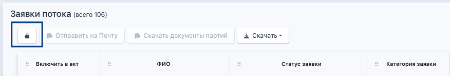
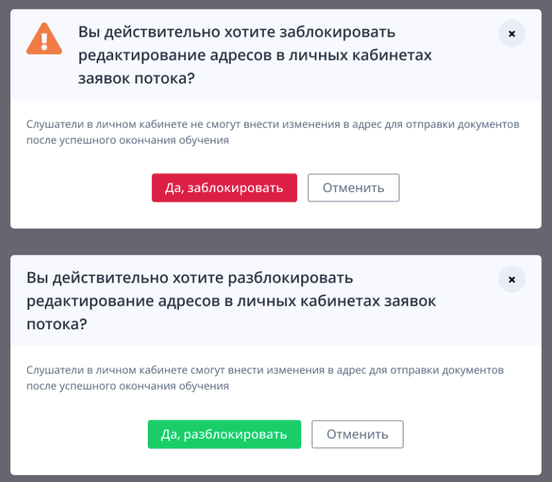

В системе есть возможность блокировки редактирования адресов для отправки документов о квалификации, выданных по окончании обучения.

В блоке "Заявки потока» на странице потока есть специальная кнопка, которая блокирует/разблокирует редактирование адресов для отправки.

{width=876px height=149px}

По умолчанию редактирование адресов не заблокировано, и они могут быть отредактированы любым пользователем, у которого есть права на это, а также гражданином в своем ЛК с разделе «Образование» (до момента отметки об отправке).

После нажатия на кнопку с закрытым замком слушатели в ЛК не смогут внести изменения в адрес для отправки документов после успешного окончания обучения. Кнопка меняется на открытый замок и повторное нажатие приведет к разблокировке редактирования адресов.

Каждое действие с кнопкой идет с подтверждением через модальное окно, чтобы удостовериться в правильности решения.

{width=799px height=698px}
